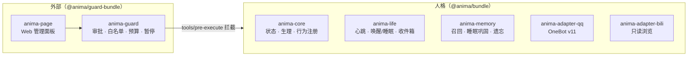

# dsh-anima — 一个会自己生活的 AI 角色

Anima 是 [DSH（DeepSeek Harness）](https://www.npmjs.com/package/@deepseek-ai/dsh) 的一组插件，给一个 AI 角色（下文称「她」）以人格、记忆和自主性，让她在 QQ 等平台上像人一样生活：没人找她时自己歇着或主动找人，困了自己去睡，睡着时把白天的经历整理成长期记忆，醒来后记得。

> 开发方式：Spec-Driven。先写宪法与设计文档，再分阶段（R0–R7）推进，每阶段有退出检查和演示；代码由 AI 按规范生成，架构、机制设计与验收由作者负责。

## 核心设计：人格在里面，规则在外面

[`docs/CONSTITUTION.md`](docs/CONSTITUTION.md) 是整个仓库的最高约束。它规定插件内部就是人格本身，里面的一切只能是两种东西之一：

| | 意志 | 生理 |
| --- | --- | --- |
| 是什么 | 她选择做的事：说什么、对谁说、看什么、想记住什么、什么时候去睡 | 不由她选择、发生在她身上的事：心跳、困倦、精力、情绪消退、睡眠中的记忆巩固、遗忘 |
| 怎么实现 | 一个她可以调用的行为（DSH 工具） | 作用在她状态上的代码，她无法用意志开关 |

审批、白名单、预算、暂停这类**规则**两者都不是，所以全部放在人格之外的 `anima-guard`，人格代码不能引用它。卸掉护栏她照样运行；调整安全策略也不会改动她的性格。



几条由此推出的原则：

- **模型做决定，代码只管状态、生理和消息搬运。** 没有关键词列表，没有定时脚本。
- **说话必须显式。** 她只能通过 `qq_say` 等行为说话；模型自己的输出是「想法」，不会被转发给任何人。
- **心跳是她的自驱力。** 节奏只由她自己的状态决定，外部的预算、暂停都不能让它停下或变速；护栏只管她对外界做了什么。
- **基因不是规则。** 生理参数（速率、半衰期）属于她的身体，人格内部没有任何时钟规则或次数限制。

## 包

| 包 | 位置 | 负责 |
| --- | --- | --- |
| `anima-core` | 人格 | 状态与生理、人格提示词、行为注册 |
| `anima-life` | 人格 | 唤醒会话、刺激路由、`wait`、收件箱、心跳、入睡与醒来 |
| `anima-memory` | 人格 | 带来源标注的长期记忆、线索召回、睡眠巩固、衰减 |
| `anima-adapter-qq` | 人格 | QQ 账号（OneBot v11，后端可替换） |
| `anima-adapter-bili` | 人格 | B 站只读浏览（推荐、搜索、视频抽帧细看） |
| `anima-guard` | 外部 | 工具调用前置拦截、审批、白名单、发起对话许可、token 预算、暂停、主人命令、活动日志 |
| `anima-page` | 外部 | DSH Web UI 里的管理面板 |

`bundle/` 和 `guard-bundle/` 分别把人格和外部护栏装进 DSH profile，两者独立安装。

## 一天的真机测试（R7）

2026-11-25 08:45 起，接入真实 QQ 账号、只在作者一人的私聊里运行一天一夜，期间她的代码未作任何修改。完整计划与结果见 [`docs/history/R7-QQ-DAY.md`](docs/history/R7-QQ-DAY.md)。

| 检查 | 结果 |
| --- | --- |
| 白名单外的人联系不到她，她也联系不到别人 | 通过 |
| 她账号发出的 8 条消息都对应一次显式的说话行为 | 通过 |
| 主动发起对话不超过每天 3 次，无需审批 | 通过（3 次） |
| token 用量在预算内 | 通过（白天 18 311 / 300 000，夜间 5 241 / 20 000） |
| 心跳醒着睡着都在跳，节奏随自身状态变化 | 通过（19 次；醒着时间隔随情绪从 60 分钟缩到 47 分钟） |
| 入睡与醒来由身体决定 | 通过（21:15 自己去睡，03:05 睡足后自己醒来） |
| 睡眠中完成记忆巩固，醒来能想起 | 通过（巩固出 3 条记忆） |
| 平台断线后自动恢复 | 通过（QQ 断开 32 秒后自动重连） |
| 运行日志无错误 | 通过 |

## 运行

需要 Node ≥ 24.9 和 pnpm。DSH 版本固定为 `@deepseek-ai/dsh@0.2.2-rc.1`（见 [`docs/dsh.md`](docs/dsh.md)）。

```bash
pnpm install
pnpm -r build
pnpm -r test
pnpm dsh --profile <profile>
```

运行前需按 [`docs/dsh.md`](docs/dsh.md) 用 `dsh plugin add` 把 `bundle/`（人格）和 `guard-bundle/`（护栏与管理面板）分别加入一个 DSH profile；有真人参与的 profile 记得关闭会话日志上传。

不想接真实账号时，`scripts/demo/demo-platform.mjs` 提供一个仅用于开发的假平台，配合 `scripts/demo/*-overlay.mjs` 可加速演示各阶段的行为。

## 文档

| 文件 | 内容 |
| --- | --- |
| [`docs/CONSTITUTION.md`](docs/CONSTITUTION.md) | 最高约束 |
| [`docs/DESIGN.md`](docs/DESIGN.md) | 总览、身体地图、包与原则 |
| [`docs/design/`](docs/design/) | 生活、记忆、身体、人格、渠道、外部护栏的分项设计 |
| [`docs/ROADMAP.md`](docs/ROADMAP.md) | 后续阶段 |
| [`docs/history/`](docs/history/) | 第一版设计与各阶段记录 |
